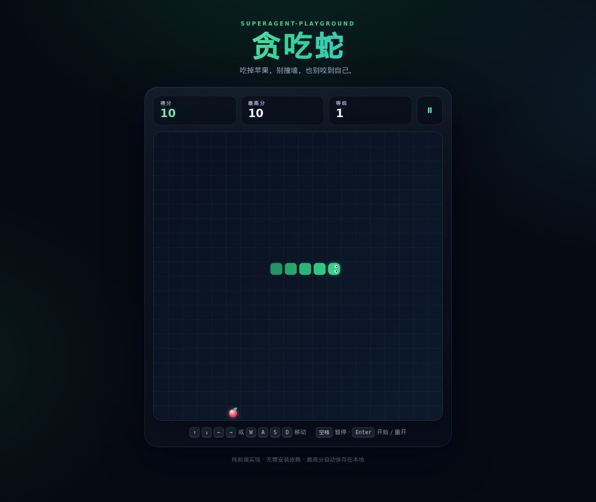

# superagent-playground

[简体中文](README.md) | English

A repository for testing superagent, with a Snake game built in vanilla HTML / CSS / JavaScript.



## Quick Start

The game has no build step and no third-party dependencies.

**Option 1: Open it directly**

Double-click `index.html`, or drag it into a browser to start playing.

**Option 2: Local static server (recommended)**

```bash
python3 -m http.server 8000
```

Then open <http://localhost:8000>. Any other static server works too, for example `npx serve .`.

## Gameplay

- **Goal**: Control the snake to eat the apples on the board; survive as long as you can.
- **Scoring**: Each apple is worth 10 points. Every 4 apples advances you to the next level, where the snake moves faster.
- **Game over**: The game ends when you hit the board edge or bite your own body; fill the entire board with the snake to win.
- **High score**: Saved automatically in the browser's localStorage and kept after a page refresh.
- **Pause**: Press Space or click the pause button in the top-right corner; the game pauses automatically when you switch to another tab.

## Controls

The game UI is currently in Simplified Chinese; the button labels below are quoted as shown on screen.

| Action | Keys |
| --- | --- |
| Start game | `Enter` / click "开始游戏" |
| Move | `↑` `↓` `←` `→` or `W` `A` `S` `D` |
| Pause / resume | `Space` |
| Restart | After game over, press `Enter` or click "再来一局" |
| Touch controls | Swipe on the board, or use the arrow buttons below it |

## Project Structure

```
.
├── index.html              # Page structure
├── styles.css              # Page, board and animation styles
├── js/
│   ├── snake-core.js       # DOM-independent game core logic
│   └── game.js             # Canvas rendering, input and timing
├── tests/
│   └── snake-core.test.js  # Unit tests for core logic
└── docs/screenshots/       # Documentation screenshots
```

## Testing

Requires Node.js 18 or later:

```bash
npm test
# or
node --test
```

## License

[MIT](LICENSE)
