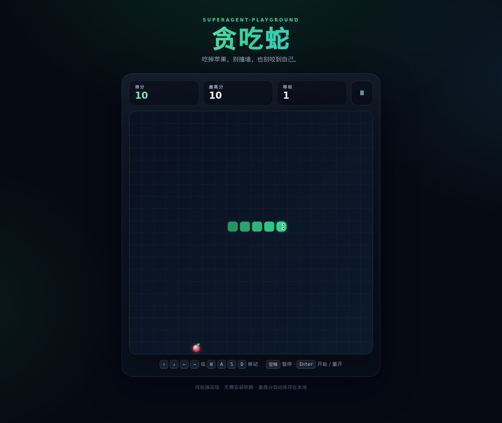

# superagent-playground

一个用于测试 superagent 的仓库，附带一个用原生 HTML / CSS / JavaScript 实现的贪吃蛇小游戏。



## 快速开始

游戏没有构建步骤，也不依赖任何第三方库。

**方式一：直接打开**

双击 `index.html`，或把它拖进浏览器即可开始。

**方式二：本地静态服务器（推荐）**

```bash
python3 -m http.server 8000
```

然后打开 <http://localhost:8000>。也可以使用其他静态服务器，例如 `npx serve .`。

## 玩法

- **目标**：控制小蛇吃掉棋盘上的苹果，存活得越久越好。
- **得分**：每吃到一个苹果得 10 分；每吃 4 个苹果升 1 级，小蛇的移动速度会加快。
- **结束**：撞到棋盘边界或咬到自己的身体时游戏结束；如果蛇身填满整个棋盘则通关。
- **最高分**：自动保存在浏览器的 localStorage 中，刷新页面后仍然保留。
- **暂停**：按空格或点击右上角暂停按钮；切换到其他标签页时游戏会自动暂停。

## 操作

| 操作 | 按键 |
| --- | --- |
| 开始游戏 | `Enter` / 点击“开始游戏” |
| 移动 | `↑` `↓` `←` `→` 或 `W` `A` `S` `D` |
| 暂停 / 继续 | `空格` |
| 重新开始 | 游戏结束后按 `Enter` 或点击“再来一局” |
| 触屏操作 | 在棋盘上滑动，或使用棋盘下方的方向键 |

## 项目结构

```
.
├── index.html              # 页面结构
├── styles.css              # 页面、棋盘与动画样式
├── js/
│   ├── snake-core.js       # 与 DOM 无关的游戏核心逻辑
│   └── game.js             # 画布渲染、输入与计时
├── tests/
│   └── snake-core.test.js  # 核心逻辑单元测试
└── docs/screenshots/       # 文档截图
```

## 测试

需要 Node.js 18 及以上版本：

```bash
npm test
# 或者
node --test
```

## License

[MIT](LICENSE)
